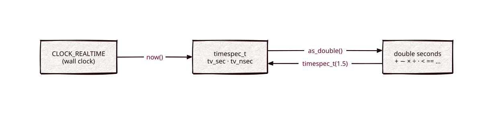

# times

Part of [Kronuz C++ Libraries](https://github.com/Kronuz/cpp-libraries), a collection of small, reusable C++ libraries.

[](https://github.com/Kronuz/times/actions/workflows/ci.yml)
[](LICENSE)


A `struct timespec` that behaves like a number, for C++20: read the wall clock
into it, convert to and from seconds as a `double`, add, subtract, scale, and
compare, with the nanosecond carry handled for you. For code that speaks
`timespec` to system calls and wants arithmetic on it.



## ✨ Highlights

- **Still a `timespec`.** `timespec_t` derives from it, so it passes straight to
  system calls.
- **Seconds in and out.** `timespec_t(1.5)` and `as_double()`.
- **Arithmetic and comparisons** that normalize nanoseconds, including a `double`
  on the left (`0.5 < ts`).
- **`now()`** reads `CLOCK_REALTIME`, with a fallback where `clock_gettime` is
  missing.

## 📦 Installation

Requires a C++20 compiler and CMake 3.14 or newer; it compiles one source file.
CI builds it on Linux (x86_64, arm64), macOS (arm64, x86_64), and FreeBSD, plus
ASan, UBSan, and TSan builds.

```cmake
include(FetchContent)
FetchContent_Declare(times
  GIT_REPOSITORY https://github.com/Kronuz/times.git
  GIT_TAG        main)
FetchContent_MakeAvailable(times)

target_link_libraries(my_app PRIVATE times::times)
```

## 🚀 Quick start

```cpp
#include "times.h"

#include <cstdio>

int main() {
	timespec_t deadline = now() + timespec_t(1.5);   // 1.5 s from now, as a timespec
	timespec_t total = timespec_t(0.6) + timespec_t(0.7);
	std::printf("%.1f s\n", total.as_double());      // 1.3 s, nanoseconds carried
	std::printf("%d\n", 0.5 < deadline);             // 1
}
```

## 🎯 When to use it

- ✅ Absolute times and timeouts for APIs that take `struct timespec`.
- ❌ Measuring elapsed time: `now()` is the wall clock, which can jump; use
  `std::chrono::steady_clock`.
- ❌ New code with no `timespec` in sight: `std::chrono` is the standard choice.

## 📚 Documentation

- [docs/API.md](docs/API.md): `timespec_t`, `now()`, the operators, and which
  clock it reads.
- [ARCHITECTURE.md](ARCHITECTURE.md): normalization and the platform fallback.
- [AGENTS.md](AGENTS.md): repository map and traps.

## 🛠️ Building and testing

```sh
cmake -B build && cmake --build build && ctest --test-dir build
```

## 🤝 Contributing

Issues and pull requests are welcome. Read [AGENTS.md](AGENTS.md) first. CI must
pass on every platform.

## 📄 License

MIT, Copyright (c) 2015-2018 Dubalu LLC. See [LICENSE](LICENSE). Extracted from
[Xapiand](https://github.com/Kronuz/Xapiand).
